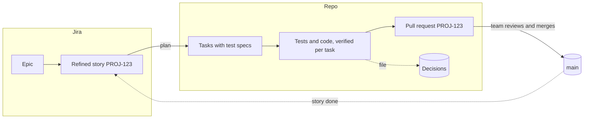

# Where Jira fits

The set ships without a Jira integration. This page shows where one would sit for a team that already shapes and tracks its work in Jira.

## The flow

Jira owns the epics, their numbering and the status of each story. The repo owns the plan, the tests, the code and the decisions. The handover point is a refined story: an outcome and acceptance criteria, under an epic.

## Which skills a Jira team would use

| Skill | In a Jira team |
| --- | --- |
| `ri-capture` | Not needed. Ideas go into Jira |
| `ri-compile` | Not needed for work items. Still useful for turning notes into decisions or runbooks |
| `ri-plan` | **Yes.** A Jira story says what to build; plan reads the code and works out how, with test specs |
| `ri-execute` | **Yes.** Tasks, verification, the story-close gate, the pull request |
| `ri-file` | Yes. Decisions and runbooks belong with the code |
| `ri-state` | Optional. A local cursor for whoever is working |
| `ri-archive` | Rarely. Jira is the history of the work |
| `ri-do` | Yes, for small fixes that don't need a story |

Going straight from a Jira story to execute works only when the story is already broken into tasks with test specs, which is rare. Without them, the verifier has nothing to check each task against.

## What would go to Jira instead of the repo

Where the repo-only setup writes a file, a Jira setup would change Jira instead.

| Moment | Repo-only setup | Jira setup |
| --- | --- | --- |
| An idea arrives | A note in `raw/` | A Jira issue |
| Work is shaped | An epic or story file in `backlog/` or `active/` | A Jira epic or story |
| A question needs a judgment call | A line in `OPEN.md` | A comment on the story |
| A story is planned | Task files in `active/` | Task files in the repo; optionally Jira sub-tasks |
| A story is done | The story file moves to `done/` | The story moves to done in Jira |
| An epic closes | An archive record | Jira closes the epic |
| Ids | `e05-s02-…`, numbered by compile | The Jira key, `PROJ-123-…`, so branches, commits and pull requests link to the issue |

Building it would need Jira access from Claude Code (Atlassian's MCP server is one route), and a decision on which changes Claude makes in Jira directly and which it proposes for a person to make.
