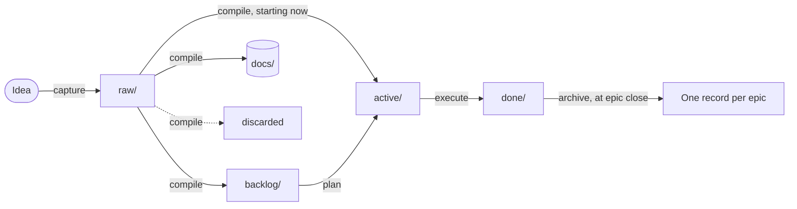
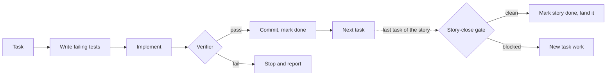

# Lifecycle

## Layout

```
.ri/config.md          repo settings: tier, stacks, test commands, landing, gate
sdlc/
  raw/                 captured material, no rules, gitignored
  work/
    backlog/           shaped, not started
    active/            in progress
    done/              finished; collapsed per epic by ri-archive
  docs/
    decisions/         ADRs
    runbooks/          operational procedures
    strategy/          direction and positioning
    architecture/      long-standing structural facts
  STATE.md             the cursor, regenerated every run
  OPEN.md              questions waiting on the operator
```

## How work moves



Inside `ri-execute`, for each task, then once per story:



For a team that shapes work in Jira, see [where Jira fits](jira.md).

| Verb | From | To | Approval |
| --- | --- | --- | --- |
| `ri-capture` | conversation, file, paste | `raw/` | none |
| `ri-compile` | `raw/` | `backlog/`, `active/`, `docs/`, or deleted | shape, then finished artefact |
| `ri-plan` | a story in `backlog/` or `active/` | the story in `active/`, plus task files | task sequence |
| `ri-execute` | tasks in `active/` | `done/` | the "go" that starts the chain; `review` tasks individually |
| `ri-file` | the session | `docs/`, or a story updated for divergence | written content |
| `ri-archive` | a closed epic's files in `done/` | one record in `done/` | grouping |
| `ri-state` | everything | `STATE.md` | none, unless the hygiene audit escalates |
| `ri-do` | a request | a commit | none at tier 1 |

Raw is the only place with no rules. Every item compile shapes leaves raw for exactly one destination, and the raw file is deleted only after a committed artefact references it.

## Epics, stories and tasks

An **epic** is a strategic commitment. Its **roadmap** lists its stories in landing order, one line each, and is the authoritative sequence. A **story** is one coherent change; it exists as a roadmap line until it is compiled on its own. A **task** is one commit's worth of work, written by `ri-plan` with a test specification.

Ids show parentage: `e05-import-reliability`, `e05-s02-retry-before-alerting`, `e05-s02-t1-retry-once-before-alerting`. See [artefacts](artefacts.md).

## When work counts as done

Marking done means setting `status: done`, refreshing `updated:`, moving the file to `done/` and committing, on the branch the work is on. `ri-execute` does it; you can also say "mark e04-s01 done" and the same checks apply.

| Level | Done when |
| --- | --- |
| Task | The verifier passes, with or without notes (tier 2 and 3). At tier 1 without a verifier: implemented, tests passing, committed. A `review` task becomes done when you approve it. |
| Story | Every task under it is done, and the story-close gate is clean or not required |
| Epic | Every story in its roadmap is done, on `main` or the current branch, and nothing under it remains in `active/` or `backlog/` |

When an epic closes, any decision, runbook, strategy or architecture drafts kept beside it move to `docs/`, and `ri-archive` collapses its files into one record. Archive and filing run before the story lands, so their commits travel with it. Under `autonomy: auto` they wait for you as lines in `OPEN.md` instead, and the story lands without them.

Marking a story done never merges it. How it lands is set by `landing:` (see [configuration](configuration.md)).

## Open questions

`OPEN.md` is the judgment queue: one line per question, tagged with the work it came from and the code module it touches.

```
- 2026-10-25 Should retries back off exponentially or at a fixed interval? [e05-s02] [area: importer]
```

| Skill | Does |
| --- | --- |
| `ri-compile`, `ri-plan`, `ri-execute` | Append, and commit the line with the work that raised it |
| `ri-state` | Counts |
| `ri-file` | Resolves and removes: as an ADR, as new work via compile, or as trivially answered |
| `ri-plan`, `ri-execute` | Surface entries tagged with the modules about to be touched |

A question raised during a story lives on the story branch until the story lands. The `merge=union` line in `.gitattributes` stops two branches that both appended a question from conflicting. Two caveats: union keeps every line from both sides, so a question `ri-file` removed on `main` can come back when a branch that appended next to it merges; and a hosted pull-request merge may not apply the driver at all. Check `OPEN.md` after merging a story that added questions.

## STATE.md

A one-screen snapshot: active focus, last completed, next, blockers, open-question count, hygiene flags, and a short notes section for facts the files can't show. It is overwritten on every run. If it disagrees with the folders, the folders win.
