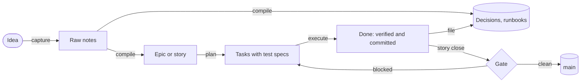
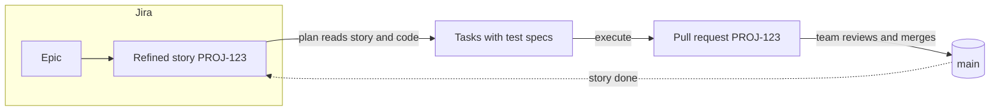

# ri-skills

A software development lifecycle for [Claude Code](https://code.claude.com/docs), built from eight skills and two review agents. Work lives as markdown files in the repo, git is the audit trail, and the amount of ceremony is set per repo by how expensive a mistake would be.

- **Filesystem as source of truth.** No tracker. Work items are markdown with YAML frontmatter, moving through `raw → backlog → active → done → archive`. State is derived from the folders, not tracked separately.
- **Thin compile, grounded plan.** Shaping an idea never invents engineering detail. Task specs are written only after the code they touch has been read.
- **Two grammars.** What the operator reads (outcome, scope, acceptance, roadmap) is in plain words about consequences. Test specs and implementation notes sit below it, for the model.
- **Ceremony proportional to risk.** Tier 1 is "just do it and commit". Tier 3 is tests first, a fresh-context verifier on every task, architectural review at planning, a security review of sensitive plans, a security gate when a story closes, and a security review across the epic when it closes.
- **Fresh-context review.** The verifier and the senior-staff reviewer are briefed with an id and a commit, never with the implementer's reasoning.

## How it flows



Each arrow is one skill. You approve the shape after compile, the task list after plan, and every merge. Execute runs the whole task list without stopping unless something fails.

### With Jira

There's no Jira integration in the set. For a team that shapes its stories in Jira, this is where the skills would sit. Capture and compile drop out, and a refined story goes straight to plan:



Jira would own the epics, the numbering and the status. The repo holds the plan, the tests, the code and the decisions. See [where Jira fits](docs/jira.md).

## The verbs

| Skill | Moves | What it does |
| --- | --- | --- |
| `ri-capture` | → raw | Saves material verbatim, no shaping |
| `ri-compile` | raw → backlog / active / docs | Shapes material into an epic, story, task, decision, runbook, strategy or architecture entry, or discards it |
| `ri-plan` | story → tasks | Reads the code, then writes a task sequence with test specs |
| `ri-execute` | active → done | Runs tasks: tests, implementation, verifier, commit. Marks tasks, stories and epics done, runs the story-close gate, lands the story |
| `ri-file` | session → docs | Records decisions, runbook changes, strategy shifts; resolves open questions |
| `ri-state` | — | Regenerates `STATE.md`, the one-screen cursor, and audits for neglect |
| `ri-archive` | done → archive | Collapses a closed epic's files into one record |
| `ri-do` | — | Tier-1 lite path: no artefact, no verifier, just the change |

| Agent | Role |
| --- | --- |
| `verifier` | Reviews a finished task against its spec and runs the tests |
| `senior-staff-engineer` | Reviews an epic, story or task plan before code is written |
| `security-reviewer` | Reviews a sensitive story's plan for threats, and a story's or epic's change against the OWASP lists |

## Quickstart

**1. Install.** The simple way is to copy the files:

```bash
git clone https://github.com/markstrefford/claude-skills.git
cp -R claude-skills/ri-skills/skills/* ~/.claude/skills/
cp claude-skills/ri-skills/agents/*.md ~/.claude/agents/
```

The better way is the plugin, one command with updates from published releases: `/plugin install ri-skills --marketplace markstrefford/claude-skills`. Both are in [docs/installation.md](docs/installation.md). You rarely type the skills by name; they trigger from plain requests in a repo that uses the SDLC.

**2. Initialise a repo:**

```bash
mkdir -p .ri sdlc/raw sdlc/work/{backlog,active,done} sdlc/docs/{decisions,runbooks,strategy,architecture}
cp claude-skills/ri-skills/examples/config-tier-2.md .ri/config.md   # or tier-1 / tier-3
echo 'sdlc/raw/' >> .gitignore
echo 'sdlc/OPEN.md merge=union' >> .gitattributes
echo 'sdlc/STATE.md' >> .gitignore      # landing: pull-request only
```

Edit `.ri/config.md`: project name, tier, test command. Every key is in [docs/configuration.md](docs/configuration.md).

**3. Run one idea through:**

```
> capture this: the nightly import should retry once before alerting
> compile that                      # proposes a story; you approve
> plan it                           # reads the import code, writes tasks
> go execute those tasks            # tests, code, verifier, commit per task
```

At the end, `STATE.md` says where things stand and `OPEN.md` holds anything waiting on your judgment.

## Documentation

| Read | For |
| --- | --- |
| [Concepts](docs/concepts.md) | The principles, the two grammars, tiers and autonomy |
| [Lifecycle](docs/lifecycle.md) | Which verb moves what, and when work counts as done |
| [Configuration](docs/configuration.md) | Every `.ri/config.md` key |
| [Artefacts](docs/artefacts.md) | Frontmatter, kinds, ids and statuses |
| [Governance](docs/governance.md) | What each tier turns on, the security reviews, and the story-close gate |
| [Models and cost](docs/models-and-cost.md) | Which model each skill runs on, and how to change it |
| [Team adoption](docs/team-adoption.md) | Settings for more than one person |
| [Where Jira fits](docs/jira.md) | Which skills a Jira team would use, and what would go to Jira |
| [Installation](docs/installation.md) | Plugin, clone, uninstall, the optional hook |
| [Troubleshooting](docs/troubleshooting.md) | Common failures |
| [Changelog](CHANGELOG.md) | Releases |

This repo runs the SDLC on itself at tier 3: `sdlc/` and `.ri/config.md` at the root are a live instance. `orion/` holds a separate set of research-writing skills that aren't part of the SDLC.

## Credits

- [Andrej Karpathy's LLM knowledge-base pattern](https://karpathy.bearblog.dev/the-llms-knowledge-base/): raw sources compiled into structured artefacts. Compile adapts it from knowledge management to development work. His tiered approach to AI-assisted coding is the tier system, applied to repos.
- [James Brawner's TLD-Skills](https://github.com/Jbrawner/tld-skills): file-first agent coordination and one skill per verb.
- [Augment Code](https://www.augmentcode.com)'s coordinator / implementor / verifier pattern: the fresh-context verifier.
- Spec-Driven Development (arXiv 2602.00180): spec-anchored work as the middle ground between vibe coding and waterfall.

Built at Reimagined Industries by Mark Strefford. MIT licensed: see [LICENSE](../LICENSE).
